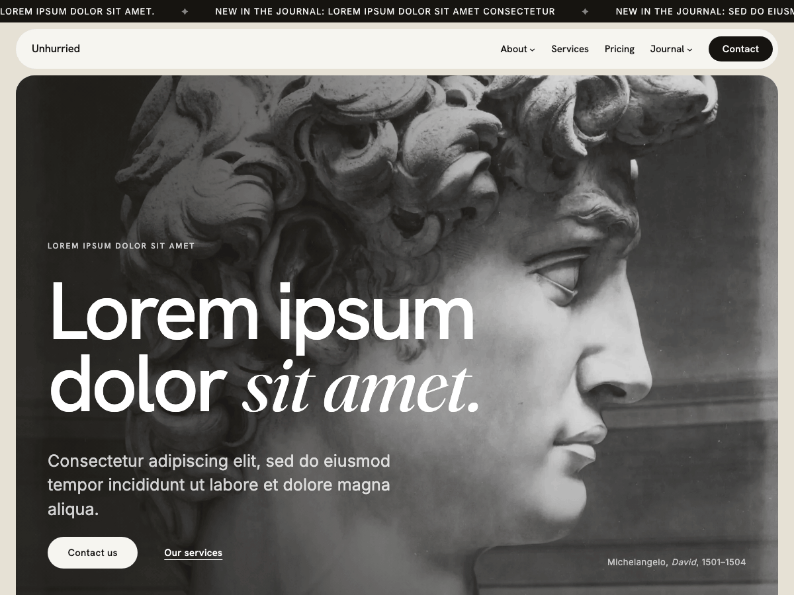

# Unhurried

A calm, editorial **WordPress block theme** for studios, spas, clinics and makers who sell care rather than speed. Made by [Switch Case Studio](https://switchcasestudio.com).

**Works with:** WordPress 6.6 or newer (tested on 7.1) · PHP 7.4+ · block themes only. It is not for Shopify, Webflow, Squarespace or other platforms.

## Install

Unhurried is in the [WordPress.org theme directory](https://wordpress.org/themes/unhurried/). In WordPress, go to **Appearance → Themes → Add New**, search for **Unhurried**, click **Install**, then **Activate**. Updates arrive like any other theme's.

To install from a zip instead, download [`unhurried.zip`](https://github.com/switchcasestudio/unhurried/releases/latest/download/unhurried.zip) from the latest release and upload it under **Appearance → Themes → Add New → Upload Theme**.

> Use the release zip, not GitHub's green **Code → Download ZIP** button. That one unpacks into a folder called `unhurried-main`, which breaks theme updates and Unhurried Pro.

## Set up your site

Open **Appearance → About Unhurried**. The setup checklist shows what is done and what is left. **Create the homepage** (and Create About, Services, Contact, Work, Pricing, Visit, Topics, Journal) opens a page with its layout and template already chosen; you edit and publish it. Other steps link straight to menus, the footer (social icons), Styles and the free plugins the theme works with: Newsletter for signups, Contact Form 7 or WPForms Lite for messages.

### By hand (2 minutes)

1. **Pages → Add New**. In the page settings, pick the **Ground artboard** template.
2. When WordPress offers page patterns, choose **Homepage**. (Or add it later: **+ → Patterns → Pages → Homepage**.)
3. Publish, then set it under **Settings → Reading → Your homepage displays → A static page**.
4. Build **About**, **Services** and **Contact** the same way with their page patterns and the **Canvas** template.

## What is included

- 48 patterns: homepage, about, services, contact, topics, work, pricing and visit pages; a marquee line for the top of the page; a numbers row; heroes (a full-screen statue hero and a spiral hero among them); a journal toolbar; an essay; a visit/process panel; a services accordion; gallery; values statement; story rows; stories grid; testimonial; call to action; gift card; price list; membership tiers; FAQ; contact details; opening hours card; map and directions; team feature; newsletter band; names strip; two header patterns (centered title, quiet) and three footers (wordmark, quiet, and one with visit details).
- A blog: stories grid, category and tag archives, single posts with comments.
- Section styles for any Group (Panel, Card, Ink, Ground, Glass) and block styles (Eyebrow, Statement, Hairline and Text-link buttons, Arch and Keep-color images).
- 20 looks under Styles: the default; eight color themes (**Orchard**, **Tide**, **Saffron**, **Lagoon**, **Rosewater**, **Studio**, **Terrace**, **Dusk**); ten tinted papers (**Nocturne**, **Linen**, **Mist**, **Moss**, **Harbor**, **Plum**, **Clay**, **Blush**, **Olive**, **Cobalt**); and **Folio**, serif italic headings on the default colors. Every text pair in every look passes WCAG AA.
- Tips: write an *italic* word in a heading for the Fraunces accent; pick the **Reveal on scroll** block style (or add the class `unhurried-reveal`) for a gentle scroll reveal; `unhurried-mono` shows a block's images in grayscale.

## Want a shop?

[**Unhurried Pro**](https://switchcasestudio.com/unhurried-pro/) adds styled WooCommerce shop, product, cart and checkout pages, a Shop shelf pattern and a lead-story blog layout. It installs on top of this theme as a child theme.

## Development

WordPress Playground demo: `dev/serve.sh free` (or `pro`, which expects `../unhurried-pro`) serves on http://127.0.0.1:9400. `dev/validate.cjs` checks every pattern and template is block-valid; `dev/themecheck.cjs` runs the Theme Check plugin. `CHANGELOG.md` has the history.

## License and credits

© 2026 Moses Atia Poston, Switch Case Studio. GPL-2.0-or-later (see `LICENSE`). Fonts: Hanken Grotesk, Inter, Fraunces (SIL OFL 1.1). Images: StockSnap.io and WordPress.org Photo Directory, CC0 (credits in `readme.txt`). Setup help: [switchcasestudio.com](https://switchcasestudio.com).
